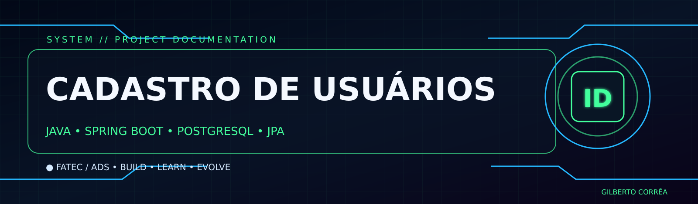
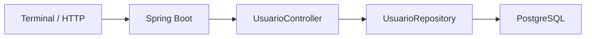

<div align="center">
  
</div>

<div align="center">

# C A D A S T R O　D E　U S U Á R I O S

### `JAVA 17 • SPRING BOOT • POSTGRESQL • JPA`

**Exercício acadêmico em Spring Boot que cadastra e lista usuários por um menu de terminal e pelas rotas HTTP `GET /usuarios` e `POST /usuarios`.**


`GILBERTO CORRÊA` · `SOFTWARE ENGINEERING` · `PROJECT DOCUMENTATION`

[Visão geral](#visao-geral) · [Recursos](#recursos) · [Arquitetura](#arquitetura) · [Execução](#execucao)

</div>

---

<a id="visao-geral"></a>

## `PROJECT // VISÃO GERAL`

Exercício acadêmico em Spring Boot que cadastra e lista usuários por um menu de terminal e pelas rotas HTTP `GET /usuarios` e `POST /usuarios`.

<a id="recursos"></a>

## `SYSTEM // INVENTÁRIO`

| Recurso | Situação |
| :--- | :--- |
| Menu de terminal | `Implementado conforme documentação` |
| GET `/usuarios` | `Lista usuários` |
| POST `/usuarios` | `Cadastra usuário` |
| PostgreSQL / JPA | `Conexão requerida` |

## `STRUCTURE // ORGANIZAÇÃO`

- `controller/UsuarioController.java` — endpoints
- `model/Usuario.java` — entidade
- `repository/UsuarioRepository.java` — JPA
- `config/DataInitializer.java` — inicialização
- `pom.xml` — dependências

<a id="arquitetura"></a>

## `ARCHITECTURE // FLUXO DO PROJETO`



<a id="execucao"></a>

## `BOOT SEQUENCE // EXECUÇÃO OU UTILIZAÇÃO`

```bash
git clone https://github.com/gilbertocorrea-cmd/cadastro-usuarios-spring.git
cd cadastro-usuarios-spring
```

Configure `DB_URL`, `DB_USERNAME` e `DB_PASSWORD` para a conexão PostgreSQL. Depois use `sh mvnw spring-boot:run`. A documentação original informa que o empacotamento foi validado, mas os testes de integração PostgreSQL não foram executados.

---

## `DOCUMENTATION // REFERÊNCIA TÉCNICA ORIGINAL`

Projeto acadêmico de Gilberto Antonio Corrêa Filho para cadastrar e listar usuários com Java, Spring Boot, JPA e PostgreSQL. Inclui menu interativo no terminal e endpoints GET e POST em `/usuarios`.

## Executar

Requer JDK 17 ou superior e PostgreSQL acessível. Configure `DB_URL` (URL JDBC), `DB_USERNAME` e `DB_PASSWORD` no ambiente. Não inclua credenciais no repositório.

```sh
sh mvnw spring-boot:run
```

O menu permite cadastrar e listar usuários. A opção 0 encerra o menu; para encerrar o servidor, use Ctrl+C.

## API

- GET /usuarios: lista usuários.
- POST /usuarios: cadastra um usuário com JSON `{"nome":"Maria"}`.

As versões de dependências do projeto original foram preservadas. Compilação e empacotamento validados com `sh mvnw -DskipTests package`. Testes de integração com PostgreSQL não foram executados.

---

<div align="center">

## `CADASTRO USUARIOS SPRING // BUILD • LEARN • EVOLVE`

**Gilberto Corrêa**

[GitHub](https://github.com/gilbertocorrea-cmd)

</div>
